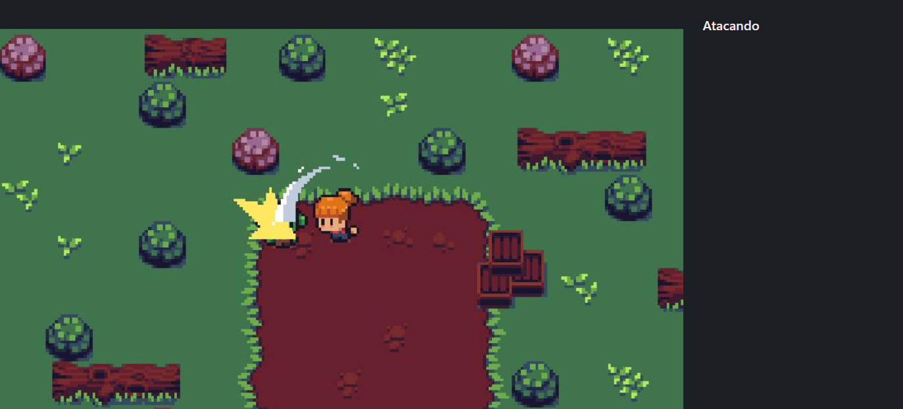
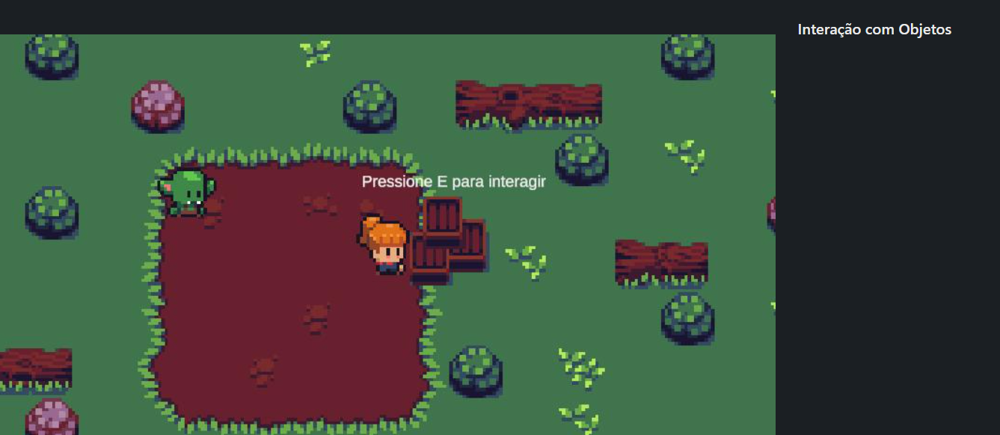
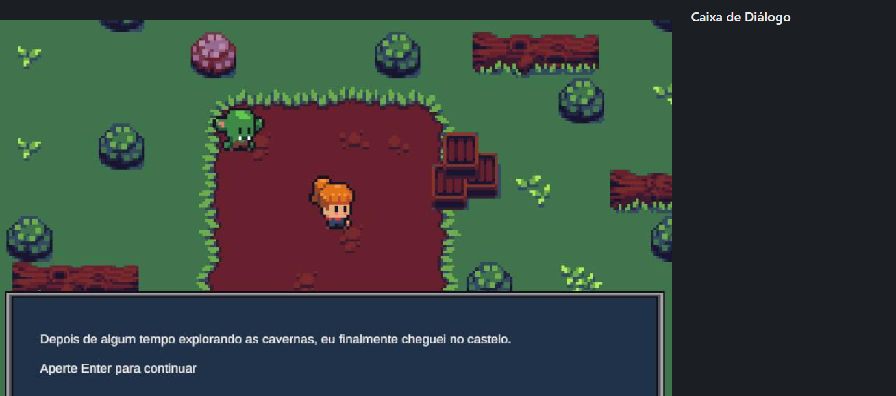
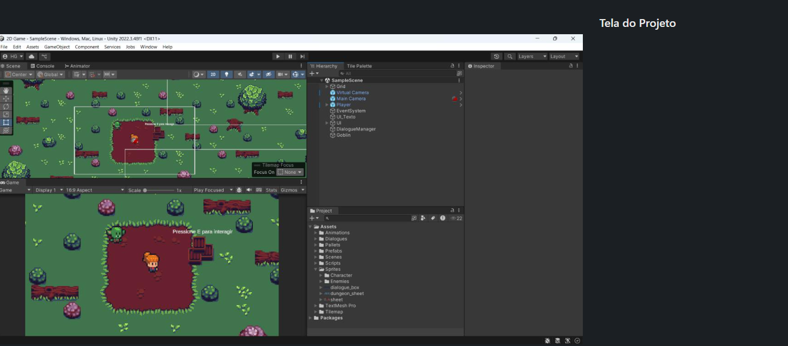

# ⚔️ An Adventure 2D Game

Um jogo de aventura em **2D Top-Down** desenvolvido na engine **Unity**. Explore o mapa, interaja com objetos do cenário, enfrente desafios e acompanhe a história através de diálogos interativos!

🎮 **[Clique aqui para jogar no itch.io](https://jakekk0.itch.io/an-adventure-game)**

---

## 📸 Screenshots

| Ataque | Interação com Objetos |
| :---: | :---: |
|  |  |

| Caixa de Diálogo | Visão da Editor/Projeto |
| :---: | :---: |
|  |  |

---

## 🛠️ Tecnologias Utilizadas

* **Game Engine:** Unity (versão 2022.3.40f1)
* **Linguagem:** C#
* **Pacotes & Recursos:**
  * **Cinemachine** (Camera Follow / Virtual Camera)
  * **Text Mesh Pro** (UI de texto e diálogos)
  * **Tilemap** (Construção e layout de cenários 2D)
  * **2D Animation & Sprites** (Animações de personagem e combate)

---

## 🎮 Funcionalidades do Jogo

* **Movimentação Top-Down:** Controle fluido de movimento em visão superior.
* **Sistema de Combate/Ataque:** Animações e mecânica de ataque corporal com efeito visual de corte (slash).
* **Interação com o Cenário:** Identificação visual de objetos interagíveis ao se aproximar (*"Pressione E para interagir"*).
* **Sistema de Diálogo:** Caixa de texto interativa com avanço de falas pressionando `Enter`.
* **Câmera Dinâmica:** Acompanhamento suave do jogador usando *Cinemachine Virtual Camera*.

---

## ⌨️ Controles

| Ação | Tecla |
| :--- | :--- |
| **Movimentação** | `W`, `A`, `S`, `D` ou `Setas` |
| **Interagir** | `E` |
| **Avançar Diálogo** | `Enter` |
| **Atacar** | `Espaço` / `Botão Esquerdo do Mouse` |

---

## 💻 Como Rodar o Projeto Localmente

### Pré-requisitos
* **Unity Hub** instalado.
* **Unity 2022.3.40f1** (ou superior).

### Passos
1. **Clone este repositório:**
   ```bash
   git clone https://github.com/seu-usuario/An-Adventure-2D-Game.git
   ```
2. Abra o **Unity Hub**.
3. Clique em **Add** (Adicionar) e selecione a pasta do projeto clonado.
4. Abra o projeto na versão do Unity correspondente.
5. Abra a cena principal localizada em `Assets/Scenes/SampleScene.unity` e pressione o botão **Play** ▶️.

---

## 📝 Licença

Este projeto está sob a licença MIT - veja o arquivo [LICENSE](LICENSE) para mais detalhes.

---
Desenvolvido por **Jakekk0** 🚀
